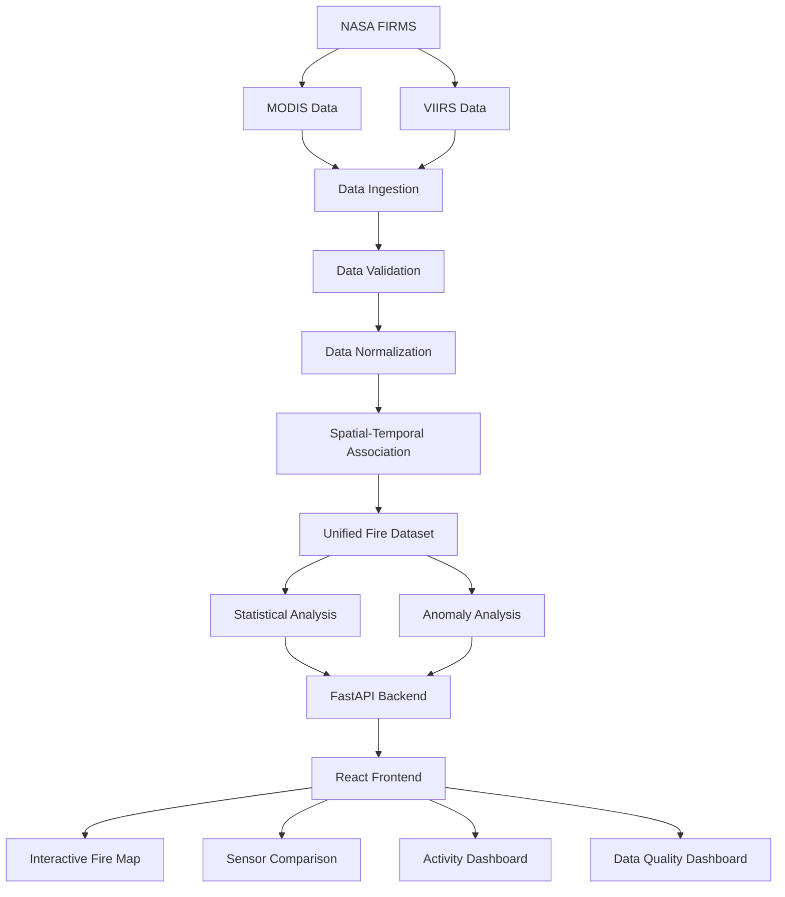

# FireLens — System Design Document

## 1. Introduction

FireLens is a web-based satellite fire intelligence platform that processes and harmonizes MODIS and VIIRS active-fire observations.

The system follows a modular architecture with separate components for data collection, processing, analysis, API services, and visualization.

## 2. System Architecture

The application consists of five major layers:

1. Data Source Layer
2. Data Processing Layer
3. Harmonization and Analysis Layer
4. Backend API Layer
5. Frontend Visualization Layer

## 3. Architecture Diagram



## 4. Main System Components

### 4.1 Data Source Layer

The platform uses NASA FIRMS active-fire datasets.

Primary data sources:

- MODIS active-fire observations.
- VIIRS active-fire observations.

The original datasets will be stored separately before processing.

### 4.2 Data Ingestion Module

Responsibilities:

- Load MODIS data.
- Load VIIRS data.
- Read CSV and other supported formats.
- Check dataset structure.
- Record source information.
- Handle missing or unavailable data.

### 4.3 Data Validation Module

Responsibilities:

- Check latitude and longitude.
- Validate timestamps.
- Identify missing values.
- Identify duplicate observations.
- Check data types.
- Record invalid records.

The system should preserve the original data and create a validation report.

### 4.4 Data Normalization Module

Different satellite datasets may use different attribute names.

The normalization module maps compatible fields into a common structure.

For example:

- Latitude → latitude
- Longitude → longitude
- Acquisition time → acquisition_time
- Fire radiative power → frp
- Satellite identifier → satellite

Sensor-specific attributes must also be preserved.

### 4.5 Harmonization Module

This module identifies potentially related observations from MODIS and VIIRS.

It uses:

- Geographic distance.
- Observation time difference.
- Sensor information.
- Available quality attributes.

The output records the relationship between observations.

A spatial-temporal match does not prove that both satellites observed the exact same physical fire.

### 4.6 Analysis Module

The analysis module performs:

- Fire observation counting.
- Geographic distribution analysis.
- Daily and monthly activity summaries.
- MODIS and VIIRS comparison.
- Fire radiative power summaries.
- Unusual activity detection.

### 4.7 Backend API

FastAPI provides endpoints to:

- Retrieve fire observations.
- Filter observations.
- Retrieve sensor comparisons.
- Retrieve activity summaries.
- Retrieve data-quality information.
- Retrieve anomaly results.

### 4.8 Frontend

The React frontend provides an interactive interface.

Main pages:

1. Overview
2. Fire Map
3. Sensor Comparison
4. Activity Calendar
5. Anomaly Analysis
6. Data Quality

## 5. Frontend Design

### Overview

Displays:

- Total observations.
- MODIS observation count.
- VIIRS observation count.
- Geographic distribution.
- Recent activity summaries.

### Fire Map

Displays:

- MODIS observations.
- VIIRS observations.
- Observation details.
- Date filters.
- Sensor filters.
- Geographic filtering.

Different marker styles should distinguish the sensors.

### Sensor Comparison

Displays:

- MODIS and VIIRS observation counts.
- Spatial distribution differences.
- Temporal comparison.
- Fire radiative power summaries.
- Matched and unmatched observations.

### Activity Calendar

Displays:

- Daily observation counts.
- Weekly activity.
- Monthly activity.
- Geographic filtering.

### Anomaly Analysis

Displays:

- Unusual changes in observation counts.
- Historical comparison.
- Anomaly scores.
- Geographic locations of unusual activity.

An anomaly indicates unusual observed activity, not a guaranteed future fire event.

### Data Quality

Displays:

- Total records processed.
- Invalid records.
- Missing values.
- Duplicate records.
- Dataset source.
- Last processing time.

## 6. Backend Design

The backend will be developed using Python and FastAPI.

Suggested project structure:

```text
backend/
│
├── app/
│   ├── main.py
│   ├── routes/
│   │   ├── fires.py
│   │   ├── comparison.py
│   │   ├── analytics.py
│   │   └── quality.py
│   │
│   ├── services/
│   │   ├── ingestion.py
│   │   ├── validation.py
│   │   ├── normalization.py
│   │   ├── harmonization.py
│   │   └── anomaly.py
│   │
│   ├── models/
│   │   └── schemas.py
│   │
│   └── data/
│       ├── raw/
│       └── processed/
│
├── requirements.txt
└── README.md
```

## 7. Data Flow

1. NASA FIRMS provides active-fire datasets.
2. The system loads MODIS and VIIRS observations.
3. The validation module checks the datasets.
4. The normalization module creates common fields.
5. The harmonization module associates potentially related observations.
6. The analysis module generates statistics and anomaly results.
7. FastAPI provides processed information.
8. React displays the results.

## 8. Design Principles

- Modular architecture.
- Separation of frontend and backend.
- Preservation of original satellite observations.
- Reproducible data processing.
- Transparent data quality.
- Scalable design.
- Clear distinction between observation and interpretation.

## 9. Future Improvements

- PostgreSQL and PostGIS integration.
- Automated satellite data updates.
- Additional satellite products.
- Advanced geospatial analysis.
- More sophisticated anomaly detection.
- Historical fire activity analysis.
