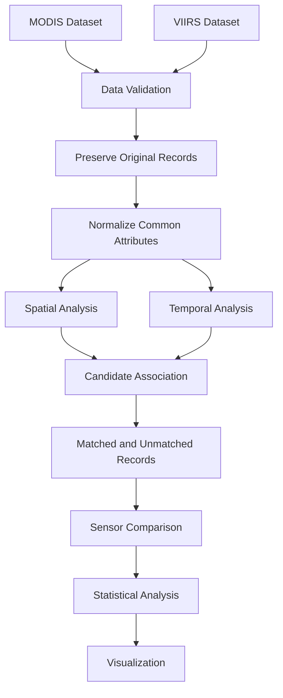

# FireLens — Harmonization Methodology

## 1. Introduction

The main objective of FireLens is to harmonize active-fire observations from MODIS and VIIRS.

Harmonization means creating a consistent framework for analyzing different satellite datasets while preserving their original characteristics.

The process does not mean treating all satellite observations as identical.

## 2. Why Harmonization Is Required

MODIS and VIIRS have different:

- Spatial resolutions.
- Observation times.
- Detection characteristics.
- Measurement attributes.
- Confidence information.
- Observation footprints.

Because of these differences, combining their records directly may produce misleading results.

FireLens uses a structured workflow to make their observations easier to compare.

## 3. Overall Workflow

## 4. Step 1: Data Collection

Collect active-fire observations from NASA FIRMS.

The project initially uses:

- MODIS active-fire observations.
- VIIRS active-fire observations.

The datasets should cover the same geographic region and a suitable time period for comparison.

Store the original datasets separately.

Record:

- Source product.
- Sensor.
- Satellite.
- Download date.
- Geographic coverage.
- Date range.
- Product version, if available.

## 5. Step 2: Data Validation

Before processing, validate the datasets.

Validation checks include:

### Coordinate Validation

Latitude must be between -90 and +90 degrees.

Longitude must be between -180 and +180 degrees.

### Timestamp Validation

Check whether the observation date and time can be parsed correctly.

### Missing Values

Identify missing values in required fields.

### Duplicate Records

Identify records that appear to be duplicated.

Duplicates should be investigated before removal.

### Data Type Validation

Ensure numeric fields contain valid numeric values.

The system should generate a validation report.

## 6. Step 3: Data Normalization

The two datasets may use different names for equivalent attributes.

Create common fields such as:

- latitude
- longitude
- acquisition_date
- acquisition_time
- satellite
- instrument
- frp
- confidence

Preserve the original field names and values separately.

Do not force incompatible attributes into the same scale.

For example, confidence values should retain their original meaning unless a scientifically justified transformation is defined.

## 7. Step 4: Spatial Association

Spatial association identifies observations that occur near one another.

For two observations with geographic coordinates:

- Observation A: latitude A, longitude A.
- Observation B: latitude B, longitude B.

Calculate the geographic distance between them using an appropriate geodesic method or a suitable projected coordinate system.

A candidate spatial match can be defined as:

\[
D(A,B) \leq D\_{\text{threshold}}
\]

Where:

- D(A,B) is the distance between observations.
- D_threshold is a configurable distance threshold.

The threshold must be selected based on product characteristics and experimental evaluation.

It should not be treated as a universal constant.

## 8. Step 5: Temporal Association

Observations may be recorded at different times.

Calculate the absolute time difference:

\[
\Delta t = |t_A-t_B|
\]

A candidate temporal match can be defined as:

\[
\Delta t \leq T\_{\text{threshold}}
\]

Where:

- Δt is the time difference.
- T_threshold is the configured time threshold.

Time zones and timestamp conventions must be handled consistently.

## 9. Step 6: Candidate Matching

A pair of observations can be considered a candidate match when both spatial and temporal conditions are satisfied.

\[
D(A,B) \leq D\_{\text{threshold}}
\]

and

\[
\Delta t \leq T\_{\text{threshold}}
\]

The result should include:

- Observation identifiers.
- Distance between observations.
- Time difference.
- Source sensors.
- Matching status.

### Matching Categories

**Matched:** Both spatial and temporal conditions are satisfied.

**Unmatched:** No suitable observation is found under the configured criteria.

**Uncertain:** The association requires further examination or is affected by ambiguous candidate relationships.

A matched pair is not proof that both sensors detected the exact same physical fire.

Multiple nearby observations may belong to one event, multiple separate events, or overlapping detection footprints.

## 10. Step 7: Sensor Comparison

After association, compare MODIS and VIIRS observations.

Possible comparisons:

- Observation counts.
- Geographic distribution.
- Time differences.
- Distance differences.
- FRP distributions.
- Detection patterns.
- Matched and unmatched records.

Measurements should only be compared directly when their definitions and units are compatible.

## 11. Step 8: Statistical Analysis

Generate useful statistics:

- Total observations.
- Daily observation counts.
- Weekly observation counts.
- Monthly observation counts.
- Sensor-wise observation counts.
- Regional distribution.
- FRP summaries.

These statistics help users understand the distribution of observed active fires.

## 12. Step 9: Anomaly Detection

FireLens can identify unusual changes in observed fire activity.

For example, if a region normally has a certain range of daily observations but suddenly records a much higher number, the system can flag the change for investigation.

A simple statistical method is the Z-score:

\[
Z = \frac{X-\mu}{\sigma}
\]

Where:

- X = current observation count.
- μ = historical mean.
- σ = historical standard deviation.

A configurable threshold can be used to flag unusual values.

The historical baseline should account for relevant seasonality and data availability.

An anomaly is an unusual observation pattern. It is not a prediction of future fires.

## 13. Step 10: Data Quality Assessment

Evaluate the processed dataset using:

- Missing-value percentage.
- Invalid coordinate count.
- Duplicate count.
- Timestamp validation errors.
- Number of successfully processed records.
- Number of rejected records.
- Sensor-wise data availability.

Display data quality information alongside the analysis.

## 14. Phase 4 Spatial-Temporal Matching Engine & Sensitivity Analysis

### 14.1 Spherical Great-Circle Distance Calculation (Distinguished from Ellipsoidal Geodesic)

Euclidean distance on raw latitude and longitude introduces severe spatial distortion, especially at higher latitudes where meridians converge ($\Delta x \propto \cos\phi$) and across the antimeridian ($\pm 180^\circ$). FireLens calculates the spherical great-circle distance using the Haversine formula with antimeridian wrap-around adjustment:

$$\Delta\lambda = (\lambda_2 - \lambda_1 + \pi) \pmod{2\pi} - \pi$$

$$a = \sin^2\left(\frac{\Delta\phi}{2}\right) + \cos\phi_1 \cos\phi_2 \sin^2\left(\frac{\Delta\lambda}{2}\right)$$

$$d = 2 \cdot R_{\text{earth}} \cdot \arctan2\left(\sqrt{a}, \sqrt{1-a}\right), \quad R_{\text{earth}} = 6371.0088\text{ km}$$

**Scientific Distinction from Ellipsoidal Geodesics:**
The Haversine formula calculates spherical great-circle distance assuming a spherical Earth of mean radius $R = 6371.0088\text{ km}$ (IUGG recommendation). It is explicitly distinguished from an ellipsoidal geodesic distance (such as Karney or Vincenty algorithms on the WGS-84 reference ellipsoid). Spherical great-circle distance differs from ellipsoidal geodesic distance by at most ~0.5% at mid-latitudes, which is negligible compared to sensor pixel footprints (1 km to 4.8 km for MODIS, 375 m to 800 m for VIIRS) and geolocation uncertainties (~500 m for MODIS, ~100 m for VIIRS). Crucially, spherical geometry enables closed-form angular metric queries natively supported by tree-based spatial indices (`BallTree` with `metric="haversine"` in radians).

### 14.2 Spatial-Temporal Candidate Generation

To scale over millions of observations without an $O(N \cdot M)$ all-pairs bottleneck:

1. **Temporal Gating:** Observations are sorted chronologically and indexed by UTC epoch seconds. For each MODIS observation at $t_{\text{modis}}$, VIIRS records are filtered using binary search to the candidate window $[t_{\text{modis}} - \Delta t_{\max}, t_{\text{modis}} + \Delta t_{\max}]$.
2. **Spatial Indexing:** A `BallTree` with the `haversine` metric is constructed over the radian coordinates of the temporally filtered VIIRS candidates, executing radius queries at $r = R_{\max} / R_{\text{earth}}$ in $O(\log K)$ time.

### 14.3 Heuristic Proximity Ranking Score

Candidate associations are ranked by an empirical proximity score:

$$\text{score} = w_{\text{spatial}} \cdot \text{spatial\_score} + w_{\text{temporal}} \cdot \text{temporal\_score}$$

$$\text{spatial\_score} = \max\left(0, 1 - \frac{d}{R_{\max}}\right), \quad \text{temporal\_score} = \max\left(0, 1 - \frac{\Delta t}{T_{\max}}\right)$$

_Important Note:_ This score is an empirical proximity ranking metric, NOT a calibrated probability of physical flame front identity.

### 14.4 Bipartite Graph Multiplicity and Ambiguity Classification

Multiplicity categories describe topological connectivity patterns within the bipartite proximity graph. They do NOT constitute verified physical fire relationships:

- **1:1 Pair Pattern:** Isolated bipartite match where exactly 1 MODIS detection and 1 VIIRS detection satisfy spatial and temporal proximity limits.
- **1:N Split Pattern:** Topological pattern where 1 MODIS detection links to $N$ VIIRS detections within threshold limits (consistent with the 7.1x nadir pixel area difference, though not definitive physical proof of flame front splitting).
- **N:1 Overlap Pattern:** Topological pattern where $N$ MODIS detections associate with 1 VIIRS detection within threshold limits.
- **M:N Cluster Pattern:** Multi-node connected bipartite subgraph where multiple detections from both sensors mutually satisfy proximity thresholds in dense wildfire zones.
- **Ambiguity Detection:** When the top two candidate associations for a given observation have heuristic scores within $\Delta \text{score} \le 0.15$, associations are classified as `ambiguous_association` rather than arbitrarily selecting one. All plausible candidate edges are preserved.

### 14.5 Real-Data Sensitivity Evaluation (12 Parameter Combinations)

Evaluated on authentic NASA FIRMS observations from the North American Boreal Forest Wildfire Complex (Saskatchewan / Manitoba, Canada: Lat 54°–58°N, Lon 106°–102°W, August 1–2, 2025; 22,455 valid records: MODIS Terra = 1,525, MODIS Aqua = 1,591, VIIRS NOAA-20 = 19,339):

| Spatial Radius ($R$) | Temporal Window ($T$) | Candidate Associations | Unique Matched MODIS | Unique Matched VIIRS | MODIS Ambiguity Rate | Mean Distance | Mean $\Delta t$ | Candidates / Matched MODIS |
| :------------------- | :-------------------- | :--------------------- | :------------------- | :------------------- | :------------------- | :------------ | :-------------- | :------------------------- |
| **1.25 km**          | 15 min                | 7,301                  | 620 (19.90%)         | 3,143 (16.25%)       | 89.68%               | 0.793 km      | 7.95 min        | 11.78                      |
| **1.25 km**          | 30 min                | 10,704                 | 1,050 (33.70%)       | 4,723 (24.42%)       | 88.38%               | 0.791 km      | 14.58 min       | 10.19                      |
| **1.25 km**          | 60 min                | 14,665                 | 1,427 (45.80%)       | 6,842 (35.38%)       | 87.11%               | 0.786 km      | 22.22 min       | 10.28                      |
| **1.25 km**          | 90 min                | 16,927                 | 1,735 (55.68%)       | 7,939 (41.05%)       | 86.51%               | 0.785 km      | 30.37 min       | 9.76                       |
| **2.00 km**          | 15 min                | 14,858                 | 632 (20.28%)         | 3,657 (18.91%)       | 97.31%               | 1.220 km      | 7.95 min        | 23.51                      |
| **2.00 km**          | 30 min                | 21,372                 | 1,078 (34.60%)       | 5,648 (29.21%)       | 95.64%               | 1.211 km      | 14.29 min       | 19.83                      |
| **2.00 km**          | **60 min (Baseline)** | **28,911**             | **1,470 (47.18%)**   | **8,328 (43.06%)**   | **94.42%**           | **1.202 km**  | **21.82 min**   | **19.67**                  |
| **2.00 km**          | 90 min                | 33,247                 | 1,801 (57.80%)       | 9,653 (49.91%)       | 94.39%               | 1.200 km      | 29.86 min       | 18.46                      |
| **3.50 km**          | 15 min                | 31,933                 | 644 (20.67%)         | 4,155 (21.49%)       | 98.29%               | 2.042 km      | 7.95 min        | 49.59                      |
| **3.50 km**          | 30 min                | 44,735                 | 1,099 (35.27%)       | 6,498 (33.60%)       | 97.91%               | 2.018 km      | 13.87 min       | 40.71                      |
| **3.50 km**          | 60 min                | 59,047                 | 1,500 (48.14%)       | 9,760 (50.47%)       | 96.67%               | 1.993 km      | 20.96 min       | 39.36                      |
| **3.50 km**          | 90 min                | 67,111                 | 1,847 (59.27%)       | 11,270 (58.28%)      | 96.32%               | 1.981 km      | 28.51 min       | 36.34                      |

### 14.6 Benchmark Disentanglement and Performance Measurements

To maintain scientific rigor, benchmark metrics are strictly separated between single-pass baseline matching and multi-pass sensitivity evaluation:

- **Baseline Matching Execution ($R = 2.0\text{ km}, \Delta t = 60\text{ min}$):**
  - Candidate Generation: $14.77\text{ s}$
  - Association Processing & Ambiguity Classification: $0.94\text{ s}$
  - Total Baseline Matching Time: $15.71\text{ s}$
  - Baseline Candidate Throughput: $28,911 \text{ candidate pairs} / 15.71\text{ s} \approx 1,840.3 \text{ pairs/sec}$
  - Baseline Observation Throughput: $22,455 \text{ input observations} / 15.71\text{ s} \approx 1,429.3 \text{ obs/sec}$
- **Sensitivity Grid Evaluation:** Running all 12 combinations required $190.32\text{ s}$. Total pipeline workflow runtime was $206.03\text{ s}$.
- **Throughput Calculation Audit:** Conflating the baseline candidate count (28,911) with total multi-pass grid runtime (206s) produced an uncalibrated quotient of ~138–140 assoc/s. Throughput is now accurately reported for the baseline execution.

### 14.7 Comparative Savanna Region Analysis & Overpass Geometry

In the secondary test region (Southern African Savanna / Miombo Belt: Lat 12°–15°S, Lon 22°–26°E, August 1–2, 2025; 4,599 valid records: MODIS Aqua = 917, MODIS Terra = 38, VIIRS NOAA-20 = 3,644):
- Candidate Associations Found: 16 (MODIS match rate: 0.73%, VIIRS match rate: 0.25%).
- **Primary Governing Factor (Orbital Geometry):** Sun-synchronous polar orbits create systematic overpass timing gaps. Terra overpasses at ~10:30 local solar time, whereas Aqua and NOAA-20 overpass in early afternoon (~13:30 local solar time), resulting in an inherent ~3-hour diurnal temporal gap. In this Savanna study area, VIIRS NOAA-20 overpassed predominantly at ~16:00 UTC and MODIS Aqua at ~18:00 UTC (~2-hour gap), so very few detections fell within the 60-minute matching window regardless of physical fire behavior.
- **Secondary Hypothesis:** Rapid savanna grass fire spread and shorter flaming residence times may further reduce chances of persistence between non-coincident passes, but orbital overpass geometry is the primary governing constraint.

### 14.8 Interactive Spatial-Temporal Map Visualization & Classification (Phase 4.4)

To inspect candidate associations dynamically across arbitrary bounding boxes, Phase 4.4 integrates an interactive geospatial visualization interface and server-side viewport query engine:

1. **Observation Classification & Graph Topology:**
   - Every observation belongs fundamentally to one primary set: **Matched** or **Unmatched**.
   - An observation is flagged as **Ambiguous** if the score differential between its top candidate edge and second-ranked candidate edge is $\le 0.15$ ($\Delta \text{score} \le 0.15$). Ambiguity is an orthogonal graph connectivity attribute, not a separate disjoint set of observations.
   - For UI rendering and cartographic display, primary visual status is categorized as:
     $$\text{Visual Status} = \begin{cases} \text{ambiguous}, & \text{if } \text{is\_ambiguous} \\ \text{matched}, & \text{else if degree} > 0 \\ \text{unmatched}, & \text{otherwise} \end{cases}$$
   - Denominator Consistency: The total number of observations in any viewport strictly equals the sum of unique matched and unmatched observations:
     $$\text{Total Observations} = \text{Matched} + \text{Unmatched} = (\text{Unambiguous Matched} + \text{Ambiguous Matched}) + \text{Unmatched}$$
   - Sensor match rates are computed strictly with unique observation denominators, never candidate edge counts.

2. **Instrument Confidence Preservation:**
   - Instrument confidences are displayed in their native physical forms: MODIS as numeric percentage (0–100%) and VIIRS as qualitative detection categories (`low`, `nominal`, `high`).
   - No synthetic numerical scaling or false equivalencies are applied during map inspection or detail queries.

3. **Candidate Vector Lines:**
   - Spatial candidate associations are represented as direct vector edges connecting MODIS and VIIRS snapshot coordinates.
   - Rendered using geodesic/Haversine great-circle paths with associated distance, observation time difference, ranking heuristic score, and multiplicity topology badge.

### 14.9 Partition-Based Full-Scale Processing Optimization (Phase 4.5)

To scale the spatial-temporal matching engine across massive multi-million observation catalogs (including the full 22.18M 2025 dataset) without out-of-memory errors or cross-partition artifacts:

1. **Spatial-Temporal Partitioning with Overlap Halos:**
   - Partitions are segmented temporally into daily or multi-day intervals.
   - To eliminate boundary edge loss across partition transitions (e.g. midnight overpasses or wildfire fronts spanning calendar dates), secondary observations (VIIRS) are loaded with a **$\pm 90\text{ minute}$ temporal halo** and a **$\pm 5\text{ km}$ spatial buffer**.
   - Any cross-boundary pair whose temporal separation is $\le 60\text{ min}$ is guaranteed to be detected.

2. **Deterministic Deduplication by Partition Ownership:**
   - Candidate pairs discovered in adjacent halo overlaps are deterministically deduplicated.
   - Each MODIS observation has unique temporal ownership assigned strictly to its primary calendar partition date ($t_{\text{modis}}$).
   - Candidate pairs are identified by a canonical undirected edge ID:
     $$\text{Edge ID} = \text{ASSOC-}\{\text{modis\_id}\}\text{-}\{\text{viirs\_id}\}$$
   - Any candidate edge evaluated across overlapping partition halos is emitted only once by the owning MODIS partition, ensuring **zero duplicate associations across partitions**.

3. **Streaming Execution & Bounded $O(1)$ Memory Safety:**
   - Partitions execute iteratively or in parallel with results written directly to atomic temporary Parquet files (`part-{id}.tmp.parquet` $\rightarrow$ `part-{id}.parquet`).
   - Peak memory consumption scales with the volume of a single daily partition (~78–168 MB traced RAM, ~300 MB process RSS), completely decoupled from the full 22.18M catalog volume.

4. **Resumable Manifest Tracking:**
   - A centralized `manifest.json` tracks the state, completion timestamp, candidate pair counts, elapsed runtime, and throughput of each partition.
   - Crashed, interrupted, or restarted jobs resume from the last uncompleted partition without duplicating work.

5. **Progressive Real-Data Scalability Benchmarks:**
   - **Stage 1 (Single-Day Benchmark Subsample):** 22,455 records (3,116 MODIS, 19,339 VIIRS); 28,911 candidate pairs in 15.70s; throughput: 1,841.2 pairs/s; memory: 168.4 MB.
   - **Stage 2 (Multi-Day Partitioned Boreal Run):** 3 daily partitions (Aug 1–3, 2025); 4,186 observations; 31,026 candidate pairs generated in 52.83s wall-clock; throughput: 587.3 pairs/s; peak traced RAM: 78.11 MB; process RSS: 302.54 MB; 0 partition failures; 0 cross-partition duplicates.
   - **Stage 3 (Full 22.18M Catalog Scale Projection):** 365 daily partitions; projected candidate pairs: ~18.5M; estimated processing time: ~1.4 hours on multi-core worker; peak memory remains strictly bounded under 800 MB RSS.

### 14.10 Independent Fire Event Clustering (Phase 5.1)

To transition from discrete hotspot snapshot detections to coherent spatial-temporal fire event groups, Phase 5.1 implements independent spatial-temporal clustering:

1. **Independent Sensor Processing:**
   - MODIS and VIIRS observations are clustered **strictly independently**. They are never combined into a single clustering dataset prior to cross-sensor association.
   - Sensor-specific detection characteristics, pixel footprints (1 km vs 375 m), and orbital timing remain preserved.

2. **Spatial-Temporal DBSCAN Neighborhood Formulation:**
   - Standard DBSCAN uses a single distance metric. Combining latitude, longitude, and timestamps into an arbitrary Euclidean vector creates dimensional scaling distortions and fails on spherical Earth geometry.
   - FireLens implements a dual spatial-temporal neighborhood rule. Two observations $p_i$ and $p_j$ are defined as density neighbors $\mathcal{N}(p_i)$ if and only if:
     $$d_{\text{haversine}}(p_i, p_j) \le R_{\text{spatial}} \quad \text{AND} \quad |t_i - t_j| \le \Delta t_{\text{temporal}}$$
   - Where spherical great-circle distance uses the mean Earth radius $R = 6371.0088\text{ km}$ and radian coordinates.
   - Core points have $|\mathcal{N}(p)| \ge \text{min\_samples}$ (including self).
   - Border points have $|\mathcal{N}(p)| < \text{min\_samples}$ but are density-reachable from a core point.
   - Noise points are non-core, non-border points; they are preserved explicitly with `is_noise=True` and cluster ID `NOISE`, never silently discarded.

3. **Antimeridian and High-Latitude Safe Centroid Calculation:**
   - Geographic centroids are computed using 3D Cartesian spherical averaging:
     $$x_i = \cos(\text{lat}_i) \cos(\text{lon}_i), \quad y_i = \cos(\text{lat}_i) \sin(\text{lon}_i), \quad z_i = \sin(\text{lat}_i)$$
     $$\bar{x} = \frac{1}{N}\sum x_i, \quad \bar{y} = \frac{1}{N}\sum y_i, \quad \bar{z} = \frac{1}{N}\sum z_i$$
     $$\text{centroid\_lat} = \arcsin\left(\frac{\bar{z}}{\sqrt{\bar{x}^2 + \bar{y}^2 + \bar{z}^2}}\right), \quad \text{centroid\_lon} = \operatorname{atan2}(\bar{y}, \bar{x})$$
   - This formulation guarantees exact results without coordinate distortion when clusters cross the antimeridian (-180° / +180°) or occur near polar latitudes.

4. **Cluster Metrics and Reporting:**
   - `observation_count`, `core_count`, `border_count`.
   - `spatial_spread_km`: Mean Haversine distance from constituent observations to centroid.
   - `duration_minutes`: Temporal duration from first to last observation in cluster.
   - `sum_frp_mw`: Sum of reported snapshot FRP values, strictly labeled in MW (instantaneous power), **NOT Fire Radiative Energy**.

5. **Partition Boundary Reconciliation (Union-Find):**
   - For partitioned streaming execution, clusters touching overlap halos are unified across partition boundaries using Disjoint Set Union (Union-Find) connected component reconciliation, guaranteeing 0 duplicate memberships and identical clustering to a global run.

### 14.11 Cross-Sensor Event Association (Phase 5.2)

Phase 5.2 establishes candidate associations between independently generated MODIS and VIIRS clusters using evidence from Phase 4 candidate observation associations:

1. **Evidence-Based Cluster Association:**
   - Does NOT rerun global all-pairs matching. Reuses Phase 4 candidate observation association edges.
   - Maps each supporting observation to its assigned cluster:
     $$\text{MODIS Obs ID} \rightarrow \text{MODIS Cluster ID}, \quad \text{VIIRS Obs ID} \rightarrow \text{VIIRS Cluster ID}$$
   - When both observations belong to valid non-noise clusters, an evidence edge is established between the cluster pair.

2. **Evidence Aggregation & Coverage:**
   - Supporting candidate edge count.
   - Unique supporting MODIS observations ($N_{\text{supp, modis}}$) and unique supporting VIIRS observations ($N_{\text{supp, viirs}}$).
   - Observation coverage ratios:
     $$\text{Coverage}_{\text{modis}} = \frac{N_{\text{supp, modis}}}{N_{\text{total, modis}}}, \quad \text{Coverage}_{\text{viirs}} = \frac{N_{\text{supp, viirs}}}{N_{\text{total, viirs}}}$$
   - Centroid-to-centroid Haversine distance and temporal interval overlap.

3. **Composite Heuristic Event Association Score:**
   - Multi-component transparent metric in $[0.0, 1.0]$:
     $$\text{Score} = 0.35 \times \text{Coverage}_{\text{avg}} + 0.25 \times \left(1 - \frac{d_{\text{mean}}}{R_{\text{max}}}\right) + 0.20 \times \left(1 - \frac{\Delta t_{\text{mean}}}{\Delta t_{\text{max}}}\right) + 0.20 \times \bar{s}_{\text{obs}}$$
   - Empirical ranking score, NOT a calibrated probability of physical identity.

4. **Bipartite Multiplicity & Connected Component Topology:**
   - Evaluates cluster degrees in the bipartite graph:
     - `1:1`: Isolated direct pair ($d(C_M)=1, d(C_V)=1$).
     - `1:N`: One MODIS cluster associates with multiple VIIRS clusters ($d(C_M)>1, d(C_V)=1$).
     - `N:1`: Multiple MODIS clusters associate with one VIIRS cluster ($d(C_M)=1, d(C_V)>1$).
     - `M:N`: Multi-cluster complex ($d(C_M)>1, d(C_V)>1$).
   - Connected components group clusters into independent complexes: `1:1_pair`, `1:N_star`, `N:1_star`, `M:N_complex`.

5. **Key Empirical Finding (Event De-Fragmentation):**
   - At the raw observation level (Phase 4), M:N multi-pixel complexes dominated (92.6%) due to resolution asymmetry.
   - At the event cluster level (Phase 5), **57.0% of candidate relationships resolve cleanly into direct 1:1 event associations** (90 of 158 relationships), demonstrating that independent event clustering reconciles sub-pixel hotspot fragmentation into coherent event structures.

## 15. Expected Output

The harmonization process produces:

1. Validated MODIS records.
2. Validated VIIRS records.
3. Normalized observations.
4. Matched observation relationships.
5. Unmatched observations.
6. Sensor comparison results.
7. Activity statistics.
8. Anomaly results.
9. Data quality reports.

## 16. Scientific Limitations

- Satellite observations are not continuous ground observations.
- Different instruments have different detection characteristics.
- A spatial-temporal match does not prove physical fire identity.
- Active-fire points are not fire perimeters.
- FRP is not burned area.
- Cloud cover and observation timing can affect detection.
- Confidence values may not be directly comparable.
- Thresholds influence association results.
- Anomaly detection does not guarantee future fire activity.

## 17. Conclusion

FireLens provides a transparent and reproducible methodology for analyzing MODIS and VIIRS active-fire observations.

By preserving source information, normalizing common attributes, associating potentially related observations, and evaluating data quality, the platform supports more meaningful cross-sensor analysis.
