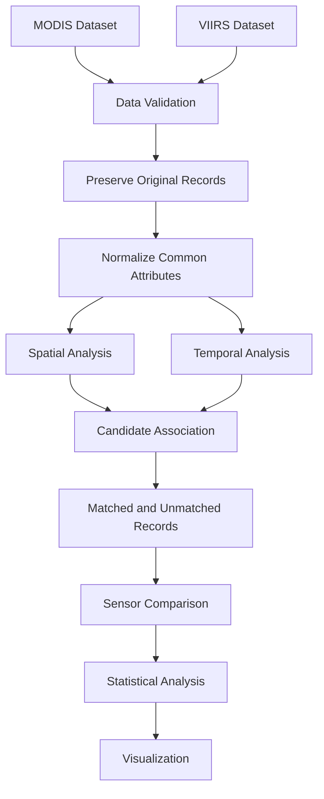

# FireLens — Harmonization Methodology

## 1. Introduction

The main objective of FireLens is to harmonize active-fire observations from MODIS and VIIRS.

Harmonization means creating a consistent framework for analyzing different satellite datasets while preserving their original characteristics.

The process does not mean treating all satellite observations as identical.

## 2. Why Harmonization Is Required

MODIS and VIIRS have different:

- Spatial resolutions.
- Observation times.
- Detection characteristics.
- Measurement attributes.
- Confidence information.
- Observation footprints.

Because of these differences, combining their records directly may produce misleading results.

FireLens uses a structured workflow to make their observations easier to compare.

## 3. Overall Workflow

## 4. Step 1: Data Collection

Collect active-fire observations from NASA FIRMS.

The project initially uses:

- MODIS active-fire observations.
- VIIRS active-fire observations.

The datasets should cover the same geographic region and a suitable time period for comparison.

Store the original datasets separately.

Record:

- Source product.
- Sensor.
- Satellite.
- Download date.
- Geographic coverage.
- Date range.
- Product version, if available.

## 5. Step 2: Data Validation

Before processing, validate the datasets.

Validation checks include:

### Coordinate Validation

Latitude must be between -90 and +90 degrees.

Longitude must be between -180 and +180 degrees.

### Timestamp Validation

Check whether the observation date and time can be parsed correctly.

### Missing Values

Identify missing values in required fields.

### Duplicate Records

Identify records that appear to be duplicated.

Duplicates should be investigated before removal.

### Data Type Validation

Ensure numeric fields contain valid numeric values.

The system should generate a validation report.

## 6. Step 3: Data Normalization

The two datasets may use different names for equivalent attributes.

Create common fields such as:

- latitude
- longitude
- acquisition_date
- acquisition_time
- satellite
- instrument
- frp
- confidence

Preserve the original field names and values separately.

Do not force incompatible attributes into the same scale.

For example, confidence values should retain their original meaning unless a scientifically justified transformation is defined.

## 7. Step 4: Spatial Association

Spatial association identifies observations that occur near one another.

For two observations with geographic coordinates:

- Observation A: latitude A, longitude A.
- Observation B: latitude B, longitude B.

Calculate the geographic distance between them using an appropriate geodesic method or a suitable projected coordinate system.

A candidate spatial match can be defined as:

\[
D(A,B) \leq D\_{\text{threshold}}
\]

Where:

- D(A,B) is the distance between observations.
- D_threshold is a configurable distance threshold.

The threshold must be selected based on product characteristics and experimental evaluation.

It should not be treated as a universal constant.

## 8. Step 5: Temporal Association

Observations may be recorded at different times.

Calculate the absolute time difference:

\[
\Delta t = |t_A-t_B|
\]

A candidate temporal match can be defined as:

\[
\Delta t \leq T\_{\text{threshold}}
\]

Where:

- Δt is the time difference.
- T_threshold is the configured time threshold.

Time zones and timestamp conventions must be handled consistently.

## 9. Step 6: Candidate Matching

A pair of observations can be considered a candidate match when both spatial and temporal conditions are satisfied.

\[
D(A,B) \leq D\_{\text{threshold}}
\]

and

\[
\Delta t \leq T\_{\text{threshold}}
\]

The result should include:

- Observation identifiers.
- Distance between observations.
- Time difference.
- Source sensors.
- Matching status.

### Matching Categories

**Matched:** Both spatial and temporal conditions are satisfied.

**Unmatched:** No suitable observation is found under the configured criteria.

**Uncertain:** The association requires further examination or is affected by ambiguous candidate relationships.

A matched pair is not proof that both sensors detected the exact same physical fire.

Multiple nearby observations may belong to one event, multiple separate events, or overlapping detection footprints.

## 10. Step 7: Sensor Comparison

After association, compare MODIS and VIIRS observations.

Possible comparisons:

- Observation counts.
- Geographic distribution.
- Time differences.
- Distance differences.
- FRP distributions.
- Detection patterns.
- Matched and unmatched records.

Measurements should only be compared directly when their definitions and units are compatible.

## 11. Step 8: Statistical Analysis

Generate useful statistics:

- Total observations.
- Daily observation counts.
- Weekly observation counts.
- Monthly observation counts.
- Sensor-wise observation counts.
- Regional distribution.
- FRP summaries.

These statistics help users understand the distribution of observed active fires.

## 12. Step 9: Anomaly Detection

FireLens can identify unusual changes in observed fire activity.

For example, if a region normally has a certain range of daily observations but suddenly records a much higher number, the system can flag the change for investigation.

A simple statistical method is the Z-score:

\[
Z = \frac{X-\mu}{\sigma}
\]

Where:

- X = current observation count.
- μ = historical mean.
- σ = historical standard deviation.

A configurable threshold can be used to flag unusual values.

The historical baseline should account for relevant seasonality and data availability.

An anomaly is an unusual observation pattern. It is not a prediction of future fires.

## 13. Step 10: Data Quality Assessment

Evaluate the processed dataset using:

- Missing-value percentage.
- Invalid coordinate count.
- Duplicate count.
- Timestamp validation errors.
- Number of successfully processed records.
- Number of rejected records.
- Sensor-wise data availability.

Display data quality information alongside the analysis.

## 14. Sensitivity Testing

The system should test different spatial and temporal thresholds.

For example:

- Smaller spatial threshold.
- Medium spatial threshold.
- Larger spatial threshold.
- Shorter time threshold.
- Longer time threshold.

Compare the number of candidate matches under different settings.

This helps demonstrate how threshold choices affect the results.

The project must document the chosen thresholds and the reasons for selecting them.

## 15. Expected Output

The harmonization process produces:

1. Validated MODIS records.
2. Validated VIIRS records.
3. Normalized observations.
4. Matched observation relationships.
5. Unmatched observations.
6. Sensor comparison results.
7. Activity statistics.
8. Anomaly results.
9. Data quality reports.

## 16. Scientific Limitations

- Satellite observations are not continuous ground observations.
- Different instruments have different detection characteristics.
- A spatial-temporal match does not prove physical fire identity.
- Active-fire points are not fire perimeters.
- FRP is not burned area.
- Cloud cover and observation timing can affect detection.
- Confidence values may not be directly comparable.
- Thresholds influence association results.
- Anomaly detection does not guarantee future fire activity.

## 17. Conclusion

FireLens provides a transparent and reproducible methodology for analyzing MODIS and VIIRS active-fire observations.

By preserving source information, normalizing common attributes, associating potentially related observations, and evaluating data quality, the platform supports more meaningful cross-sensor analysis.
